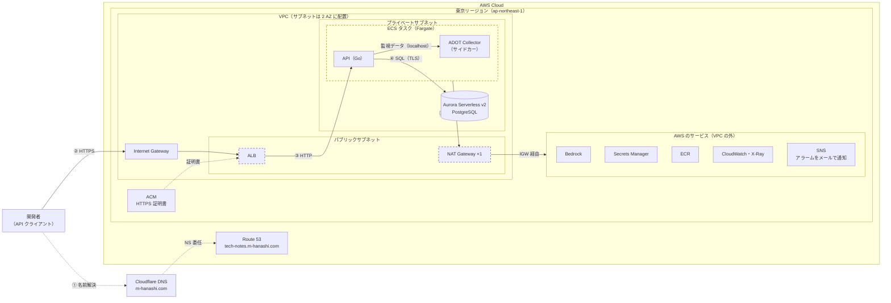
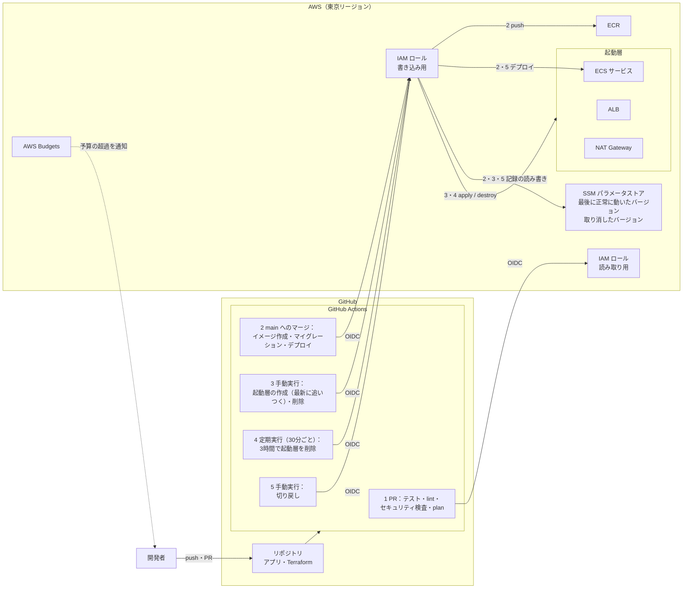
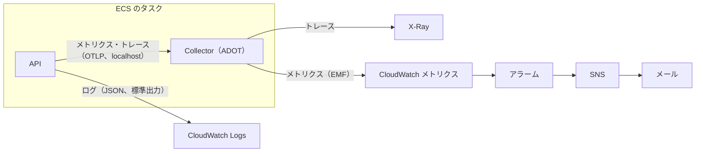

# 仕様書

## 1. 目的と背景

### 1.1 概要

本プロジェクトは、AWS 上で小規模な Web API を構築・運用する、個人の技術検証プロジェクトです。
Web サービスの運用に必要な技術とプラクティスを、実際に動作する環境で検証することを目的とします。

### 1.2 背景

Web サービスでは、機能の実装に加えて次のことが求められます。

- インフラを再現できること
- 安全にリリースできること
- 障害の原因を調査しやすいこと
- 性能と信頼性を継続的に改善できること

これらは、実際に構築・運用し、計測と改善を繰り返さなければ検証できません。

### 1.3 目的

小規模な API を題材に、次の6項目を実践します。

| # | 項目 | 内容 |
|---|---|---|
| 1 | 再現可能な基盤構築 | AWS 環境を Terraform でコード化し、同じ構成を何度でも作成・削除できる状態にする |
| 2 | 安全なリリース | CI/CD パイプラインで、テスト・品質チェック・デプロイを自動化する。問題のある変更はリリース前に止め、リリース後に問題が見つかった場合は元に戻せるようにする |
| 3 | 可観測性 | メトリクス・ログ・トレースを取得し、リクエスト単位で処理を追跡できるようにする |
| 4 | 性能・信頼性の改善 | SLI/SLO を定義し、計測結果にもとづいて改善する。その過程を記録として残す |
| 5 | AI 機能の統合 | 生成 AI を利用した機能を API に組み込み、ほかの機能と同じ基準で監視・運用する |
| 6 | 検証環境の起動・停止 | 検証環境は必要なときだけ起動・構築し、利用後は課金対象となる一時的なリソースを停止・削除する。停止忘れを防ぐため、自動停止の仕組みも設ける。Terraform state や再構築に必要な設定・データは保持し、安全に環境を再構築できるようにする |

各項目の完成条件と検証方法は、第2章で定義します。

### 1.4 開発の原則

- **運用まで行う**：構築して終わりにしない。実際に運用・計測・改善を行い、その記録をリポジトリに残す
- **アプリケーションは最小限にする**：機能は、上記の検証に必要なものに限定する
- **AI 駆動開発を採用する**：開発に AI を活用する。ただし生成されたものは必ずレビューし、設計判断・実装内容・検証結果を自分で説明できる状態にする
- **セキュリティを全体に共通する要件として扱う**：アプリケーション・CI/CD・インフラ・AI 機能のすべてで、セキュリティを設計・検証の対象とする
- **判断を記録する**：重要な技術判断は ADR に記録し、比較した選択肢と選んだ理由を残す

## 2. 到達目標と検証方法

### 2.1 方針

第1章の6つの目的と、全体に共通するセキュリティについて、完成条件・検証方法・証跡を定義します。

完成条件は、次の2つに分けます。

| 区分 | 定義 |
|---|---|
| MVP | その目的の核となる条件。これを満たさなければ、目的を達成したとは言えないもの。最初に達成する |
| 発展 | 達成すると質が高まるが、なくても目的の核は示せる条件。MVP の達成後に取り組む |

検証は、次の原則で行います。

- **第三者が確認できること**：証跡はリポジトリに残すか、再実行できる手順として残す
- **異常系で確かめること**：正常に動くことだけでなく、意図的に障害や不正な状態を作り、仕組みが働くことを確かめる
- **目標と手段を分けること**：完成条件には「何を達成するか」を書き、「どう実現するか」は書かない。決定済みの技術は記載してよい。未決定の技術を挙げる場合は「（例：○○）」と記載し、採用するかどうかは第4章以降で判断する

本章では、Terraform で管理するリソースを次の2層に分けて扱います（詳細は第6章）。

| 層 | 内容 |
|---|---|
| 常設層 | 常に保持するリソース。料金がかからないか、休止できるもの（VPC、Aurora など） |
| 起動層 | 利用するときだけ作成するリソース。起動中に時間単位の料金がかかるもの（ALB、NAT Gateway、ECS サービスなど） |

### 2.2 再現可能な基盤構築

**核**：環境を削除しても、コードから同じ構成を再作成できること。

| 区分 | 完成条件 | 検証方法 | 証跡 |
|---|---|---|---|
| MVP | コンソールを手で操作せず、コードだけで常設層と起動層を作成できる。初回のみ必要な準備（Terraform state の保存先など）は手順書にする | 何もない AWS アカウントから、手順書とコードだけで環境を作成し、API が応答することを確認する | 手順書、実行ログ |
| MVP | 作成直後の状態が、コードと一致している | 作成後に `terraform plan` を実行し、差分がないことを確認する | plan の結果 |
| MVP | インフラを変更する PR に、plan の結果が自動で表示される | インフラを変更する PR を作成し、表示を確認する | PR |
| 発展 | コードと実環境のずれ（ドリフト）を、定期的に自動で検知できる | コンソールから設定を意図的に変更し、検知されることを確認する | 検知の記録 |
| 発展 | Terraform のコードをモジュールに分割し、別の環境を少ない記述で作成できる | 2つ目の環境を作成する | コード |

### 2.3 安全なリリース

**核**：問題のある変更をリリース前に止め、リリース後に問題が見つかった場合も元に戻せること。

| 区分 | 完成条件 | 検証方法 | 証跡 |
|---|---|---|---|
| MVP | PR を作成すると、テストと静的解析が自動で実行される。失敗した場合はマージできない | テストが失敗する変更を意図的に作り、マージできないことを確認する | CI の実行履歴、PR |
| MVP | main へのマージをきっかけに、イメージの作成から ECS へのデプロイまでが、手作業なしで行われる | マージから、新しいバージョンが応答するまでを確認する | CD の実行履歴 |
| MVP | 新しいバージョンが起動しない、またはヘルスチェックに失敗した場合、自動で前のバージョンに戻り、API は停止しない | 起動しないバージョンを意図的にデプロイし、切り戻されることと、その間も API が応答し続けることを確認する | 検証記録 |
| MVP | リリース後に不具合が見つかった場合、定められた手順で1つ前のバージョンに戻せる | 不具合のあるバージョンをデプロイし、手順どおりに切り戻す。所要時間を記録する | 手順書、検証記録 |
| MVP | DB のマイグレーションがデプロイの流れに組み込まれている。失敗した場合はデプロイを中止する | 失敗するマイグレーションを意図的に含め、デプロイが中止され、DB が変更前の状態のままであることを確認する | 検証記録 |
| 発展 | リリース後のエラー率の上昇を検知し、自動で切り戻せる | リリース後にエラーが増えるバージョンをデプロイし、自動で切り戻されることを確認する | 検証記録 |
| 発展 | カナリアリリースまたはブルーグリーンデプロイで、段階的に切り替えられる | 段階的に切り替わることを確認する | 検証記録 |
| 発展 | ステージング環境で確認してから、本番環境にデプロイする | 2つの環境を順に経由することを確認する | CD の実行履歴 |

### 2.4 可観測性

**核**：遅延やエラーが発生したときに、原因の箇所を外部から特定できること。メトリクスで異常に気づき、トレースで箇所を絞り込み、ログで原因を確認する、という流れでたどれる状態を目指す。

| 区分 | 完成条件 | 検証方法 | 証跡 |
|---|---|---|---|
| MVP | API のリクエスト数・エラー率・レイテンシを、エンドポイントごとにダッシュボードで確認できる | 負荷をかけ、値が変化することを確認する | ダッシュボード |
| MVP | ECS と Aurora の主要な指標（CPU、メモリ、DB の接続数など）を、同じダッシュボードで確認できる | 値が表示されることを確認する | ダッシュボード |
| MVP | 1つのリクエストを、API から DB・AI の呼び出しまで、トレースで追跡できる | 実際のリクエストのトレースを確認する | トレース |
| MVP | ログが構造化（JSON）され、トレース ID によってログとトレースを相互にたどれる | エラーや遅延を意図的に発生させ、ダッシュボード → トレース → ログの順に原因箇所を特定する | 調査手順の記録 |
| MVP | ダッシュボードもコードで作成され、環境を再作成しても再現される | 起動層を再作成し、ダッシュボードが同じ状態で表示されることを確認する | コード |
| 発展 | 監視データの送信先を別の監視ツール（例：Grafana Cloud）に切り替え、アプリケーションのコードを変更せずにデータが届く | 送信先を切り替え、メトリクス・トレース・ログが届くことと、アプリケーションのコードに変更がないことを確認する | 検証記録 |
| 発展 | 外形監視で、利用者の視点から正常性を確認できる | API を停止し、検知されることを確認する | 検知の記録 |
| 発展 | 代表的な障害について、調査手順書（ランブック）がある | 手順書どおりに調査できることを確認する | 手順書 |

アラートは 2.5、AI 固有の指標は 2.6 で扱います。

### 2.5 性能・信頼性の改善

**核**：合格とする水準を数値で定め、計測し、実際に改善すること。

本環境は常時稼働しないため、SLO は起動している時間のみを対象として評価します。具体的な目標値と評価期間は第8章で定めます（8.3）。

| 区分 | 完成条件 | 検証方法 | 証跡 |
|---|---|---|---|
| MVP | SLI と SLO が文書で定義され、ダッシュボードで達成状況を確認できる。AI 要約には、ほかのエンドポイントとは別の SLO を定める | ダッシュボードで値を確認する | SLO 定義書、ダッシュボード |
| MVP | SLO を下回るおそれがあるときに、アラートが通知される | 障害を意図的に発生させ、通知が届くことを確認する | 通知の記録 |
| MVP | 負荷試験の手順があり、性能のベースラインが記録されている | 定めた条件で負荷試験を実施する | 試験手順、試験結果 |
| MVP | 計測 → 原因の特定 → 改善 → 再計測の流れで、性能または信頼性を1件以上改善した記録がある | 同じ条件で、改善の前後を比較する | 改善記録（前後の数値を含む） |
| 発展 | 障害訓練を行い、ポストモーテムを作成した | 障害を注入し、検知・復旧・振り返りまでを行う | ポストモーテム |
| 発展 | エラーバジェットのバーンレートに基づいてアラートを出す | 消費の速さを変え、通知の違いを確認する | 検証記録 |
| 発展 | エラーバジェットを使い切った場合の運用ルールがある | ルールを文書化する | ルール文書 |
| 発展 | 負荷試験を CI で定期的に実行し、性能の劣化を検知できる | 性能が劣化する変更を意図的に入れ、検知されることを確認する | CI の実行履歴 |
| 発展 | 改善記録が複数ある | — | 改善記録 |

### 2.6 AI 機能の統合

**核**：生成 AI を利用した機能を組み込み、ほかの機能と同じ基準で監視・運用すること。応答が遅い、外部サービスとして失敗や呼び出し回数の制限がある、使用量に応じて料金がかかる、出力が一定でない、といった AI に特有の性質を、運用の観点で扱えるようにする。

| 区分 | 完成条件 | 検証方法 | 証跡 |
|---|---|---|---|
| MVP | AI 要約が API として動作する | 実際の AI を使い、手動で動作を確認する | 動作の記録 |
| MVP | AI の呼び出し部分をテストダブル（モック）に差し替えて、自動テストできる。CI では実際の AI を呼び出さない | CI でテストが成功することを確認する | CI の実行履歴 |
| MVP | AI の呼び出しにタイムアウトがある。AI の障害（タイムアウト、エラー、呼び出し回数の制限）が発生しても、要約のみが定められたエラーを返し、ほかの機能は正常に動作する | AI の呼び出しを意図的に失敗させ、動作を確認する | テスト結果、検証記録 |
| MVP | AI の呼び出し回数・レイテンシ・エラー率・トークン使用量を、ダッシュボードで確認できる | 要約を実行し、値が変化することを確認する | ダッシュボード |
| 発展 | 生成した要約を保存して再利用し、AI の呼び出しを減らす | 同じメモを2回要約し、2回目は AI を呼び出さないことを確認する | 検証記録、トークン使用量の変化 |
| 発展 | トークン使用量の上限を定め、超えた場合は呼び出しを制限する | 上限を低く設定し、制限されることを確認する | 検証記録 |
| 発展 | 要約の品質を評価する仕組みがある | 評価を実行する | 評価結果 |
| 発展 | 設定の変更だけで AI のモデルを切り替えられ、モデルごとの品質・速度・コストを比較した記録がある | 2つのモデルで比較する | 比較の記録 |
| 発展 | 要約を非同期で処理する | — | — |

### 2.7 検証環境の起動・停止

**核**：必要なときだけ環境を稼働させて不要な料金を防ぎ、削除しても安全に再作成できること。

| 区分 | 完成条件 | 検証方法 | 証跡 |
|---|---|---|---|
| MVP | 1回の操作で、起動層を作成・削除できる | 作成と削除を行う | 実行履歴 |
| MVP | 起動から一定時間（3時間）が経過すると、起動層が自動で削除される | 起動したまま放置し、自動で削除されることを確認する。削除の遅延時間も記録する | 実行履歴 |
| MVP | 削除後、時間単位で課金されるリソースが残っていない。Aurora は休止している | 削除後に、リソースの一覧と Aurora の状態を確認する。翌日に請求情報も確認する | 確認結果の記録 |
| MVP | 起動層を削除して再作成しても、登録したデータと設定が保持されている | データを登録 → 削除 → 再作成 → データを取得する | 検証記録 |
| MVP | 予算のしきい値を超えるおそれがあるときに、通知が届く | しきい値を低く設定して確認する | 通知の記録 |
| MVP | 自動停止の処理が失敗したときに、通知が届く | 権限を意図的に外して失敗させ、通知が届くことを確認する | 通知の記録 |
| 発展 | 起動中に操作すると、自動停止までの時間を延長できる | 延長し、削除の時刻が変わることを確認する | 実行履歴 |
| 発展 | 一定時間アクセスがない場合に、自動で削除される | アクセスのない状態を作り、削除されることを確認する | 実行履歴 |
| 発展 | AWS 側のスケジューラー（例：EventBridge Scheduler）で、定刻に削除される | 予約した時刻に削除されることを確認する | 実行履歴 |
| 発展 | 月ごとの料金と稼働時間を、リソースの種類ごとに確認できる | 料金のレポートを確認する | レポート |
| 発展 | 起動にかかる時間を計測し、短縮した記録がある | 改善の前後で起動時間を比較する | 改善記録 |

### 2.8 セキュリティ

**核**：アプリケーション・CI/CD・インフラ・AI 機能のすべてで、権限・秘密情報・通信・データを安全に扱うこと。

| 区分 | 対象 | 完成条件 | 検証方法 | 証跡 |
|---|---|---|---|---|
| MVP | CI/CD | 秘密情報をリポジトリに含めない。GitHub Actions から AWS へは、長期のアクセスキーを使わず、OIDC による一時的な認証で接続する | CI で秘密情報の検出スキャンを実行する。長期のアクセスキーが発行されていないことを確認する | スキャン結果、設定 |
| MVP | アプリ / インフラ | DB の認証情報などは、秘密情報を管理するサービスに保管し、実行時に取得する。コードや設定ファイルには記載しない | コードと設定に秘密情報がないことを確認する | 設定 |
| MVP | 全体 | 役割（API、CI、自動停止）ごとに、必要最小限の権限のみを付与する。AI は、使用すると定めたモデルのみを呼び出せる | 権限のない操作が拒否されることを確認する | 検証記録 |
| MVP | インフラ | 外部からの通信は HTTPS のみを受け付ける。DB には API からのみ接続できる | HTTP でのアクセスと、API 以外からの DB への接続が拒否されることを確認する | 検証記録 |
| MVP | インフラ | DB に保存したデータが暗号化されている | 設定を確認する | 設定 |
| MVP | アプリ | 認証されていないリクエストを拒否する | 認証されていないリクエストが拒否されることを、テストで確認する | テスト結果 |
| MVP | CI/CD | CI で、依存ライブラリの既知の脆弱性と、Terraform の危険な設定を自動で検出する | 脆弱性のあるライブラリや危険な設定を意図的に入れ、検出されることを確認する | CI の実行履歴 |
| MVP | AI | AI に渡す入力は対象のメモの本文のみとし、AI の出力がほかのデータや操作に影響しない設計にする | 本文にプロンプトインジェクションを含めて要約し、影響がないことを確認する | 検証記録 |
| 発展 | アプリ / AI | レート制限を設け、AI 機能の大量呼び出しを防ぐ | 上限を超えたリクエストが拒否されることを確認する | テスト結果 |
| 発展 | CI/CD | コンテナイメージの脆弱性を検出する | スキャン結果を確認する | スキャン結果 |
| 発展 | AI | AI の入出力を検査し、不適切な内容を遮断する（例：Bedrock Guardrails） | 不適切な入力が遮断されることを確認する | 検証記録 |
| 発展 | インフラ | Web アプリケーションへの攻撃の防御と、脅威の検知を導入する（例：AWS WAF、GuardDuty） | 検知されることを確認する | 検証記録 |
| 発展 | 全体 | AWS 上の操作ログ（例：CloudTrail）を確認し、権限の設定を定期的に見直す | 見直しの記録を残す | 見直しの記録 |

## 3. 題材とスコープ

### 3.1 題材

技術メモを登録・参照し、生成 AI で要約できる Web API「Tech Notes」を題材とします。

この題材は、第2章の完成条件を検証するための手段として選んでいます。次の性質を、最小限の機能で備えているためです。

- DB への書き込みと読み込みがある（データの保持、マイグレーション、性能改善の題材になる）
- 外部の生成 AI を呼び出す機能がある（AI 機能の統合を検証できる）
- 機能が少なく、アプリケーション開発の負担が小さい

### 3.2 MVP の機能

| 機能 | 内容 | 主に検証する目的 |
|---|---|---|
| メモの登録 | タイトルと本文を保存する | DB への書き込み、入力の検証、トレース |
| メモの取得 | 指定した1件のメモを返す | レイテンシの SLO |
| メモの一覧 | 保存したメモを一覧で返す | 負荷試験と性能改善 |
| AI 要約 | 指定したメモの本文を、生成 AI で要約して返す | AI 機能の統合 |
| ヘルスチェック | API が正常に動作しているかを返す | デプロイの成否の判定 |

API の設計（エンドポイント、データ項目）と認証の方式は、第4章で定めます。

### 3.3 MVP のスコープ外

次の機能は MVP には含めず、発展の段階で検討します（3.4 を参照）。

| 機能 | MVP に含めない理由 |
|---|---|
| 画面（Web UI） | アプリケーション開発の作業が大きく増えるため。MVP では、動作の確認をコマンドやテストツールから行う |
| メモの更新・削除 | なくても、第2章の完成条件の検証に影響しないため |
| ユーザー登録・ログイン | 利用者を管理しない簡易な認証で、アクセス制御の完成条件を満たせるため |

なお、本番運用（実際の利用者に向けた提供）は、本プロジェクトの対象外とします。

### 3.4 発展の段階で検討する機能

MVP の達成後に、第2章の発展の条件とあわせて検討します。

| 機能 | 主に検証できること |
|---|---|
| 要約の非同期処理 | 再試行、失敗時の扱い、処理待ちの量の監視など、信頼性の設計 |
| キャッシュ | 改善の前後を数値で比較する題材 |
| キーワード検索 | DB の検索性能の改善 |
| AI によるタグ付け | 2つ目の AI 機能。要約とのコストや速度の比較 |
| メモの更新・削除 | 一般的なメモアプリとしての機能の充足 |
| ユーザー登録・ログイン | 本格的な認証の仕組み |
| 画面（Web UI） | 画面を配信する仕組みの構築 |
| AI による意味検索 | ベクトル検索（例：PostgreSQL の pgvector） |

### 3.5 前提条件と制約

| 項目 | 内容 |
|---|---|
| 開発体制 | 個人（1名）。開発には AI を活用する |
| クラウド | AWS（東京リージョン） |
| 利用形態 | 常時稼働はしない。学習・検証・デモのときだけ、週に数回、数時間程度起動する |
| 予算 | 月 $30 程度を目安とする。技術検証に必要な場合は、一時的な超過を許容する |
| 停止の運用 | 手動での起動・停止を基本とする。停止忘れに備え、起動から一定時間（3時間）で自動停止する |
| コストの安全網 | 予算のしきい値を超えるおそれがあるときに通知を受け取る |
| ドメイン | 取得済みの独自ドメイン（Cloudflare で管理）を使用する |

## 4. アーキテクチャと技術選定

### 4.1 全体構成

AWS の東京リージョンに、ALB・ECS on Fargate・Aurora Serverless v2 を中心とした構成を作ります。
リソースは、停止中も残す「常設層」と、使うときだけ作る「起動層」に分けます（図では、起動層を破線で示します）。

#### 図4-1　アプリケーション構成

1. **名前解決**：m-hanashi.com は Cloudflare で管理し、サブドメイン tech-notes.m-hanashi.com を Route 53 に委任します。API のアドレスは api.tech-notes.m-hanashi.com です。
2. **リクエスト**：HTTPS のリクエストを ALB で受け付け、プライベートサブネットの API に渡します。
3. **データ**：API は Aurora Serverless v2 にデータを保存します。Aurora は、使わないときに自動で休止します。
4. **外向きの通信**：API から Bedrock・Secrets Manager・ECR・CloudWatch・X-Ray への通信は、NAT Gateway と Internet Gateway を経由します。
5. **監視**：API の監視データは、同じタスクのサイドカー（ADOT Collector）を経由して CloudWatch と X-Ray に送ります。アラームは SNS からメールで通知します（第8章）。

#### 図4-2　CI/CD・運用の構成

- GitHub Actions は、OIDC で IAM ロールの一時的な認証情報を取得します。長期のアクセスキーは使いません。
- PR のワークフローには読み取り用のロールだけを渡し、確認前のコードが AWS を変更できないようにします（4.5 を参照）。
- 起動層は、手動で作成・削除します。削除し忘れても、定期実行が起動から3時間後に削除します。
- デプロイ・起動・切り戻しは、SSM パラメータストアの「最後に正常に動いたバージョン」と「取り消したバージョン」の記録をもとに動きます（7.3〜7.6）。

#### 常設層と起動層

| 層 | 主なリソース | 停止中の料金 |
|---|---|---|
| 常設層 | VPC・サブネット・Internet Gateway、Aurora、ECR、ECS クラスター、Secrets Manager、IAM、Route 53、ACM、SSM パラメータ、SNS トピック、CloudWatch のロググループ | 発生する（Route 53、Secrets Manager、Aurora のストレージなど。少額） |
| 起動層 | ALB、NAT Gateway、ECS サービス、CloudWatch のアラームとダッシュボード | 発生しない（削除するため） |

時間で課金されるリソースと、公開 IPv4 アドレスを使うリソースは、起動層に集めます。

このほか、Terraform の state を置く S3 バケットと予算の通知（AWS Budgets）は、最初に一度だけ実行する「準備用」の構成で作ります（6.1）。

### 4.2 技術選定

主要な技術と、選んだ理由の要約です。比較の詳細は ADR に記録します。

| 分野 | 選定 | 主な理由 |
|---|---|---|
| クラウド・リージョン | AWS 東京リージョン | 検証の対象とするサービスがそろっている。利用者（自分）に近い |
| IaC | Terraform | 広く使われており、常設層と起動層を分けて管理できる |
| CI/CD | GitHub Actions | リポジトリと同じ場所で動き、OIDC で AWS に一時的な認証で接続できる |
| アプリケーションの言語 | Go | 単一のバイナリで小さなコンテナを作れる。AWS SDK と OpenTelemetry の対応が整っている |
| 実行環境 | ECS on Fargate | サーバーの管理が不要で、ALB・オートスケーリング・デプロイの仕組みを一通り検証できる |
| データベース | Aurora Serverless v2（PostgreSQL） | 使わないときに自動で休止し、データを残したまま料金を抑えられる。RDS と同じリレーショナル DB の運用を経験できる |
| 生成 AI | Amazon Bedrock（Converse API） | AWS の中で完結し、IAM で呼び出せるモデルを制限できる。Converse API により、モデルを差し替えやすい |
| 監視 | CloudWatch・X-Ray、計装は OpenTelemetry | AWS の中で完結する。計装を OpenTelemetry にすることで、アプリケーションのコードを変えずに送信先を差し替えられる |
| API の認証（MVP） | 固定の API キー | 利用者を管理しない簡易な認証で、MVP の完成条件を満たせる |

#### 生成 AI のモデル

具体的なモデルは、段階1で候補を2〜3個試して選びます。選ぶ基準は次のとおりです。

1. 東京リージョンから使える（クロスリージョン推論を使う場合は、日本国内で処理される方式を優先する）
2. Converse API に対応している
3. 日本語の要約に十分な質がある
4. 小さく速いモデルを優先する

### 4.3 ネットワークと DNS

| 項目 | 設計 |
|---|---|
| VPC | パブリックサブネットとプライベートサブネットを、それぞれ 2 つの AZ に作る（ALB と Aurora の要件） |
| 配置 | ALB と NAT Gateway はパブリックサブネット、API（ECS）と Aurora はプライベートサブネットに置く |
| 外向きの通信 | NAT Gateway を1つだけ使う。料金を抑えるため、AZ ごとには置かない |
| AWS サービスへの経路 | NAT Gateway を経由する。VPC エンドポイントは料金が増えるため、MVP では使わない |
| DNS | m-hanashi.com は Cloudflare で管理し、tech-notes.m-hanashi.com を Route 53 に委任する。Cloudflare には NS レコードを一度だけ手動で追加する |
| API のアドレス | api.tech-notes.m-hanashi.com。ALB を指すエイリアスレコードを、起動層の作成時に Terraform で作る |
| HTTPS | 証明書は ACM で発行し、Route 53 による DNS 検証で自動で更新する。ALB で HTTP を HTTPS に転送する |

**引き受ける課題**：NAT Gateway が1つのため、その AZ に障害が起きると、API から外への通信（Bedrock など）ができなくなります。検証環境のため、この影響は許容します。

### 4.4 API の設計（案）

#### エンドポイント

| 機能 | メソッドとパス | 認証 | 成功時 |
|---|---|---|---|
| メモの登録 | `POST /notes` | 必要 | 201 と、登録したメモ |
| メモの取得 | `GET /notes/{id}` | 必要 | 200 と、メモ1件 |
| メモの一覧 | `GET /notes?limit=20` | 必要 | 200 と、新しい順のメモの一覧 |
| AI 要約 | `POST /notes/{id}/summary` | 必要 | 200 と、要約の文章 |
| ヘルスチェック | `GET /health` | 不要 | 200 |

#### データ項目（メモ）

| 項目 | 型 | 制約 |
|---|---|---|
| id | UUID | API が発行する |
| title | 文字列 | 必須。200文字以内 |
| body | 文字列 | 必須。10,000文字以内（AI 要約の料金と処理時間の上限を決めるため） |
| created_at | 日時 | API が記録する |

#### 方針

- 一覧の `limit` は、既定 20 件・最大 100 件とする。件数が増えたときの改善（ページ送りの方式など）は、性能改善の題材にする
- 要約は、呼び出されるたびに生成して返し、DB には保存しない。AI の出力がほかのデータに影響しない設計にするため（2.8）
- エラーは、JSON で理由を返す。入力の誤りは 400、認証の失敗は 401、メモが見つからない場合は 404 とする。生成 AI の失敗や時間切れの扱いは、第5章で定める

### 4.5 セキュリティ設計

2.8 のセキュリティの完成条件（MVP）を、次の設計で満たします。

| 対象 | 設計 |
|---|---|
| 通信の制限 | セキュリティグループで、インターネットから ALB へは HTTPS のみ、API へは ALB からのみ、Aurora へは API からのみ接続を許可する |
| 通信の暗号化 | インターネットと ALB の間は HTTPS。API と Aurora の間は TLS。ALB と API の間は暗号化しない（下記の判断1） |
| API の認証 | リクエストヘッダーの API キーを、アプリケーションで照合する。キーは Secrets Manager に保管する。照合は一定時間比較で行い、ヘルスチェックは対象外とする。認証の部分は、ほかの方式に差し替えられる構造にする |
| 秘密情報 | API キーと DB のパスワードは Secrets Manager に保管し、実行時に取得する。コード・設定ファイル・ログには含めない |
| DB の認証 | Aurora が作成したパスワードを Secrets Manager に保管し、定期的に自動で更新する（下記の判断2） |
| 保存データの暗号化 | Aurora と Secrets Manager は、AWS が管理する鍵で暗号化する（下記の判断3） |
| 権限 | API・CI・自動停止の役割ごとに IAM ロールを分ける。API のロールは、使用すると定めた Bedrock のモデルだけを呼び出せるようにする。CI のロールは、読み取り用と書き込み用に分ける（下記の判断4） |
| AI の入力 | AI に渡すのは対象のメモの本文だけとし、要約の結果を保存や操作に使わない |

#### 主な判断

| # | 論点 | 判断 | 理由 | 発展 |
|---|---|---|---|---|
| 1 | ALB と API の間の暗号化 | 暗号化しない | API は外から直接届かない場所にあり、ALB からの通信だけを許可する。全区間の暗号化が必要な情報は扱わず、証明書の管理を増やす利点が小さい | 全区間の暗号化を試し、必要になる条件を整理する |
| 2 | DB の認証方式 | パスワード（Secrets Manager） | 一般的な方法で確実に動かすことを優先する。パスワードの自動更新に備え、接続に失敗したら読み直す処理を入れる | IAM 認証にして、長期間使えるパスワードをなくす |
| 3 | 暗号化の鍵 | AWS が管理する鍵 | どちらの鍵でも暗号化されることは同じで、鍵を細かく制御する必要がない。Aurora の鍵はあとから差し替えられないため、変える場合は作り直す | 自分で管理する鍵を使い、鍵のポリシーでアクセスを制限する |
| 4 | CI の権限 | 読み取り用と書き込み用の2ロール | PR は確認前のコードで動くため、読み取りだけに制限する。書き込み用は、main ブランチで動くワークフロー（マージ・手動実行・定期実行）からのみ使えるようにする。広めの権限から始め、CloudTrail の記録をもとに削る | ワークフローごとにロールを分ける |

### 4.6 ほかの章で定めること

| 項目 | 定める章 |
|---|---|
| 生成 AI の失敗・時間切れの扱い、プロンプトの設計 | 第5章 |
| Terraform の state の保存先、ECS クラスターをどちらの層に置くか | 第6章 |
| デプロイの方式、マイグレーションの実行方法 | 第7章 |
| OpenTelemetry Collector の配置、SLO の目標値 | 第8章 |

## 5. AI 活用

本プロジェクトでは、AI を2つの形で使います。開発の道具としての AI（5.1）と、API の機能としての AI（5.2）です。

### 5.1 開発での AI 活用

開発には、AI のコーディング支援ツール（Claude Code）を使います。1.4 の原則（生成されたものは必ずレビューし、自分で説明できる状態にする）を守るため、次のルールを設けます。AI 駆動開発そのものには、完成条件を設けません。

| ルール | 内容 |
|---|---|
| 説明できない変更は入れない | AI が書いたコードも自分で読み、説明できないものは main に入れない |
| 変更は PR を通す | AI が書いたものも、PR と CI を通してから main に入れる |
| AWS の変更は人が承認する | Terraform の apply・destroy や AWS の設定変更を、AI が自分の判断で実行しない。実行は CI か、人の承認を経て行う |
| 秘密情報を渡さない | パスワードや API キーを、AI に見せない |
| ルールをツールに組み込む | 上記のルールを、プロジェクトの CLAUDE.md（AI が毎回読み込む指示書）に書く |

AI が関わった変更は、次のように記録します。

- コミットに、AI が共同作成者であることを示す行（Co-Authored-By）を付ける
- PR の説明に、判断したことを短く書く

### 5.2 AI 要約の設計

#### 処理の流れ

1. API が、対象のメモの本文を DB から取得する
2. 指示（システムプロンプト）と本文を分けて、Bedrock の Converse API に送る
3. 返ってきた要約を、そのまま利用者に返す。要約は DB に保存しない

#### プロンプト

| 項目 | 設計 |
|---|---|
| 指示と本文の分離 | 指示はシステムプロンプトに書き、本文は `<note>` などの印で囲んで渡す。本文の中の指示には従わないよう、システムプロンプトで指示する |
| 要約の形 | 3行以内の箇条書き。メモが英語でも、要約は日本語で返す |
| 出力の上限 | 出力のトークン数に上限を設け、料金と処理時間を一定以下に抑える |
| ばらつきの抑制 | 温度（出力のランダムさ）を低めに設定する |
| 管理 | プロンプトは Go のコードに書き、Git で管理する。変更は PR で確認する |

形が決まっているため、「3行以内か」「各行が箇条書きか」をプログラムで確認できます。3行を超える出力が返った場合の扱いは、段階1で実際の出力を見て決めます。

#### 遅いとき・失敗したとき

要約1回につき、待つ時間の上限を合計15秒とします。再試行は AWS SDK の標準の仕組み（間隔を空けて最大3回）に任せ、15秒を超えたら打ち切ります。

| 失敗の種類 | 返すステータス | エラーの理由（例） |
|---|---|---|
| 時間切れ | 504 | `ai_timeout` |
| 呼び出し回数の制限 | 503（再試行してよい時間を添える） | `ai_throttled` |
| そのほかの AI のエラー | 502 | `ai_error` |

- 失敗の種類を分けることで、監視で「遅い」「混んでいる」「壊れている」を見分けられるようにする
- 上限の時間を設けることで、要約の処理がたまり、ほかの機能まで遅くなることを防ぐ
- 要約の失敗は、ヘルスチェックの結果に含めない。AI が使えなくても、デプロイを失敗と判定しないため
- 15秒は見込みの値であり、段階1で実際の応答時間を測って調整する

#### 監視とコスト

| 記録する項目 | 用途 |
|---|---|
| 呼び出し回数 | 使用状況の把握 |
| レイテンシ | 上限の時間が適切かの判断 |
| 結果（成功・時間切れ・回数制限・エラー） | 失敗の種類ごとの件数の把握 |
| 入力と出力のトークン数 | 料金の算出（トークン数×単価） |
| モデル名 | モデルの比較 |

- OpenTelemetry で記録し、トレースにも付ける。項目名は、生成 AI 向けの標準の名前（例：`gen_ai.usage.input_tokens`）に従う
- 送った本文と返ってきた要約の中身は記録しない。完成条件は数値で満たせ、ログに不要な情報を残さないため。要約の品質に問題があった場合は、同じ本文で再現して調べる

#### テスト

- AI の呼び出し部分はインターフェースとして定義し、テストでは偽物（テストダブル）に差し替える。CI では実際の AI を呼び出さない
- 時間切れ・回数制限・エラーを返す偽物を用意し、5.2 の失敗時の振る舞いを自動テストで確かめる
- 実際の AI での動作は、手動で確認する

#### モデル

具体的なモデルは、4.2 の基準にもとづいて段階1で選びます。API のロールは、選んだモデルだけを呼び出せるように制限します（4.5）。

### 5.3 発展

2.6 の発展の条件にあわせて、次のことに取り組みます。

- 生成した要約を保存して再利用し、AI の呼び出しを減らす
- トークン使用量の上限を定め、超えた場合は呼び出しを制限する
- 要約の品質を評価する仕組みを作る
- 設定の変更だけでモデルを切り替え、品質・速度・コストを比較する
- 要約を非同期で処理する

## 6. IaC と環境運用

### 6.1 Terraform の構成

Terraform のコードは、役割ごとに3つに分け、それぞれ別の state で管理します。

| 構成 | 内容 | state の置き場所 | apply する人 |
|---|---|---|---|
| 準備用 | state を置く S3 バケットと、予算の通知（AWS Budgets）を作る。最初に一度だけ実行する | 手元 | 自分（手元） |
| 常設層 | VPC・サブネット・Internet Gateway、Aurora、ECR、ECS クラスター、Secrets Manager、IAM、Route 53、ACM、SSM パラメータ、SNS トピック、CloudWatch のロググループ | S3 | 自分（手元） |
| 起動層 | ALB、NAT Gateway、ECS サービス、CloudWatch のアラームとダッシュボード | S3 | GitHub Actions |

#### state の保存

- state は S3 バケットに置き、S3 の機能でロックする（同時に書き込まれないようにする）
- バケットは、バージョン管理・暗号化・外部からのアクセスの遮断を有効にする
- state を置くバケット自体は Terraform より先に必要なため、準備用のコードで作る

#### 層の間の情報の受け渡し

常設層は、起動層が必要とする値（VPC やサブネットの ID、証明書、ECR の場所など）だけを、SSM パラメータストアに書き込みます。起動層は、そこから値を読みます。

- 受け渡す値が一覧になり、層の間の依存関係がはっきりする
- 起動層を扱うロールに、常設層の state 全体を読む権限を与えずに済む

#### タグ

すべてのリソースに、プロジェクト名と層を示すタグ（例：`Project=tech-notes`、`Layer=launch`）を、Terraform で自動で付けます。自動停止は、このタグでリソースを見分けます。

### 6.2 起動・停止・自動停止

| 操作 | 方法 | 処理 |
|---|---|---|
| 起動 | GitHub Actions の手動実行 | 起動層を作成する（`terraform apply`） |
| 停止 | GitHub Actions の手動実行 | 起動層を削除する（`terraform destroy`） |
| 自動停止 | GitHub Actions の定期実行（30分ごと） | 起動から3時間を過ぎていたら、起動層を削除する |

#### 自動停止の判断

- タグの付いた NAT Gateway と ALB の作成時刻を AWS から読み、どちらかが3時間を過ぎていたら、起動層を削除する
- 起動のワークフローの記録ではなく、実際に AWS にあるリソースを見ることで、起動が途中で失敗した場合や、手元から起動した場合でも、料金がかかるリソースを取りこぼさないようにする
- 削除の処理は、すでに消えているリソースがあっても問題なく完了するようにする（何度実行しても同じ結果になる）
- 自動停止までの時間の延長は、MVP では行わない

#### 失敗の通知と安全網

| 備え | 内容 |
|---|---|
| ワークフローの失敗の通知 | GitHub の標準の通知（失敗するとメールが届く）を使う。AWS に接続できない場合でも届く |
| 予算の通知 | AWS Budgets で、料金がしきい値を超えるおそれがあるときに通知を受け取る。GitHub Actions が動かない場合の最後の安全網とする |
| 定期実行の停止への備え | GitHub は、公開リポジトリに60日間更新がないと定期実行を止める。運用手順書に、定期実行が有効になっているかの確認を入れる |

### 6.3 変更の確認

常設層の変更は、内容を理解してから反映します。そのため、変更が AWS に反映されるまでの各段階に、確認なしには進めない仕組みを置きます。

| 段階 | 仕組み | 防ぐこと |
|---|---|---|
| AI の操作 | AI のコーディング支援ツールの権限設定で、`terraform apply`・`terraform destroy`・PR のマージ・`git push`・ワークフローの手動実行・リポジトリの削除と設定の変更を禁止する | AI が自分の判断で変更を反映すること |
| main への反映 | ブランチ保護で、PR を通すことと、CI（plan を含む）の成功を条件にする | 確認していない変更が main に入ること |
| main への反映 | PR のひな形に、「変わること」と「なぜ」を書く確認の欄を設ける。Terraform を変えたときは、plan に作り直しや削除があるかも「変わること」に書く。AI が会話で内容を整理し、利用者は理解してから自分で書き写す | 内容を理解しないままマージすること |
| AWS への反映 | 常設層の apply は手元で行い、確認を省くオプション（`-auto-approve`）は使わない。直前に表示される計画を読んでから反映する | 計画を確認せずに反映すること |

常設層の apply を CI で行わないことで、CI の書き込み用ロールに、IAM ロールや Aurora を作成・削除する権限を与えずに済みます。apply の後は `terraform plan` を実行し、コードと環境に差分がないことを確認します。

起動層の作成・削除（GitHub Actions の手動実行）は、この確認の対象外です。起動層は、料金を抑えるために作成と削除を繰り返すものであり、コードの変更は PR と CI を通るためです。

### 6.4 データの保護

| 対象 | 設計 |
|---|---|
| Aurora の削除防止 | AWS 側の削除防止と、Terraform 側の削除防止（`prevent_destroy`）の2重にする |
| Aurora のバックアップ | 自動バックアップを7日分保持し、その範囲の任意の時点に戻せるようにする。削除する場合は、最後のスナップショットを自動で取る |
| state の保護 | S3 バケットのバージョン管理に加え、Terraform 側の削除防止を付ける |

バックアップから実際に復元できることを、段階3または段階4で一度確認し、手順書に残します。

### 6.5 初回の準備

次の作業は、初回に一度だけ行い、手順書にまとめます（2.2）。

1. 準備用のコードで、state を置く S3 バケットと、予算の通知を作る（料金が発生する前に安全網を用意するため）
2. 常設層を apply する
3. Cloudflare に、tech-notes.m-hanashi.com を Route 53 に委任する NS レコードを手動で追加する
4. GitHub に、OIDC で使う IAM ロールの情報を登録する
5. 最初のイメージを作成して ECR に保存し、そのタスク定義を登録して、「最後に正常に動いたバージョン」として記録する（7.3）

### 6.6 発展

- 定期的に plan を実行し、コードと実環境のずれ（ドリフト）を自動で検知する
- 常設層の apply を、承認の操作を挟んだ CI で行う方式を試し、手元で行う方式と比較する
- AWS 側にも、起動層の削除し忘れを検知する仕組み（例：NAT Gateway が4時間以上存在したら通知）を設ける
- 2.7 の発展の条件（時間の延長、アクセスがない場合の自動削除など）に取り組む

## 7. CI/CD

### 7.1 ワークフローの全体像

| ワークフロー | きっかけ | 使う IAM ロール | 主な処理 |
|---|---|---|---|
| CI | PR の作成・更新 | 読み取り用 | テスト・静的解析・セキュリティ検査、`terraform plan` の結果の表示 |
| CD | main へのマージ | 書き込み用 | イメージの作成・保存。起動層が動いていれば、マイグレーションとデプロイ |
| 起動 | 手動実行 | 書き込み用 | 起動層の作成。main の最新が記録より新しければ、続けてデプロイ |
| 停止 | 手動実行 | 書き込み用 | 起動層の削除 |
| 自動停止 | 定期実行（30分ごと） | 書き込み用 | 起動から3時間を過ぎていれば、起動層の削除（6.2） |
| 切り戻し | 手動実行 | 書き込み用 | 指定したバージョン（省略時は1つ前）へのデプロイ |

同じ ECS サービスを同時に変更しないよう、CD・起動・停止・自動停止・切り戻しは、GitHub Actions の同時実行の制御（concurrency）で、同時に動かないようにします。ただし、この仕組みで待機できる実行は1つだけで、新しい実行が来ると、待機中の古い実行は取り消されます。停止や自動停止が取り消される場合に備え、停止のあとは起動層が削除されたことを確認します。実際の動きは段階4で確かめます。

書き込み用のロールは、main ブランチで動くワークフロー（マージ・手動実行・定期実行）からだけ使えるようにし、OIDC で受け取る情報で確認します。main 以外のブランチで手動実行されたワークフローは、PR を通っていない内容で動くためです。

### 7.2 CI

| 検査 | ツール |
|---|---|
| Go のテスト | `go test` |
| Go の静的解析 | golangci-lint |
| 秘密情報の検出 | gitleaks |
| 依存ライブラリの脆弱性 | govulncheck |
| Terraform の書式・文法 | `terraform fmt`、`terraform validate` |
| Terraform の危険な設定 | Trivy（設定の検査） |
| インフラの変更内容 | `terraform plan` の結果を PR にコメントする |

- いずれかの検査が失敗した場合は、マージできない（ブランチ保護。6.3）
- 依存ライブラリの更新は、Dependabot が PR を作成する
- ワークフローで使う外部の部品（Actions）は、書き換えられる名札（例：`@v4`）ではなく、コミット ID で指定する。部品が改ざんされた場合に、自分の CI で動くことを防ぐため

### 7.3 デプロイ

デプロイは、CD が ECS を直接更新する方式とします。

1. イメージを作成し、Git のコミット ID をタグとして ECR に保存する
2. 新しいイメージを使うタスク定義を、ECS に登録する
3. マイグレーションを、ECS の単発タスクとして実行する（7.4）。失敗した場合は、ここでデプロイを中止する
4. ECS サービスを、新しいタスク定義に切り替える
5. 切り替えが、自動の切り戻しではなく、手順2で登録したタスク定義で完了したことを確認してから、そのバージョンを「最後に正常に動いたバージョン」として SSM パラメータストアに記録する。自動で切り戻された場合も、サービスは（古いバージョンで）正常な状態になるため、「正常な状態になったか」だけでは判断しない。確認の具体的な方法は、段階5で検証する

#### Terraform との関係

- 起動層の Terraform は、起動層を作成するときに「最後に正常に動いたバージョン」の記録を読み、そのバージョンのタスク定義でサービスを作る。Terraform はタスク定義を作らない
- 作成後のバージョンの切り替えは CD が行い、Terraform はその変更を差分として扱わない設定にする。これにより、デプロイ後も `terraform plan` の差分がない状態を保つ
- CD の書き込み用ロールには、タスク定義に IAM ロールを渡す権限（`iam:PassRole`）を、API 用のロールに限定して与える

#### タスク定義のひな形

タスク定義のひな形（API と Collector のコンテナ、Collector のイメージのバージョンと設定）は、アプリケーションと同じリポジトリに置きます。CD は、コミットごとに、ひな形にイメージのタグなどを埋めてタスク定義を登録します。これにより、Collector の変更（第8章）も、アプリケーションの変更と同じデプロイ・自動の切り戻し・記録の流れを通ります。

- 「最後に正常に動いたバージョン」には、コミット ID と、そのとき登録したタスク定義を記録する。タスク定義は起動層を削除しても残るため、起動時はそのタスク定義をそのまま使う
- 起動時の追いつき（7.5）は、通常のデプロイと同じく、main の最新のひな形からタスク定義を登録する
- 切り戻し（7.6）は、指定したコミットのひな形からタスク定義を登録し直す
- ひな形に入れるロールやロググループの名前は、常設層が SSM パラメータストアに記録した値を使う

#### 「最後に正常に動いたバージョン」を記録する理由

ECR の最新のイメージや、最新のタスク定義を使うと、起動に失敗して自動で切り戻されたバージョンも対象になってしまいます。正常な状態を確認できたバージョンだけを記録することで、起動層を作り直したときに、問題のあるバージョンで起動することを防ぎます。

#### イメージの管理

| 項目 | 設計 |
|---|---|
| タグ | Git のコミット ID。イメージとコードを1対1で対応させる |
| 上書きの禁止 | 同じタグのイメージを上書きできないようにする（イミュータブル） |
| 保持数 | 最新の30個を残し、古いイメージは自動で削除する |

### 7.4 マイグレーション

- マイグレーションのコマンドは、アプリケーションと同じイメージに含める
- CD が、新しいタスク定義を使った ECS の単発タスクとして1回だけ実行し、成功してからサービスを切り替える
- PostgreSQL では、スキーマの変更もトランザクションの中で実行できる。マイグレーションが途中で失敗した場合も、DB は変更前の状態に戻る
- マイグレーションは、1つ前のバージョンのアプリケーションでも動く変更（追加）に限る。切り替えの途中や自動の切り戻しのときに、古いバージョンが新しいスキーマで動くため。列の削除や名前の変更は、「追加 → 移行 → 削除」の複数回のデプロイに分ける（Expand / Contract）
- マイグレーションのツールは、段階1で選ぶ

### 7.5 起動層が停止しているときのマージ

起動層が停止している間に main へマージした場合、CD はイメージの作成と保存だけを行い、デプロイは行いません（失敗とはしません）。

次に起動するときは、記録されたバージョンで起動層を作成したあと、main の最新のバージョンが記録と異なれば、続けて 7.3 のデプロイを行います。起動のときも通常のデプロイと同じ流れを通るため、マイグレーションと自動の切り戻しが同じように働きます。

ただし、切り戻したバージョン（7.6）は、この追いつきの対象にしません。切り戻しのときに「取り消したバージョン」を SSM パラメータストアに記録し、main にそれより新しいコミットが入るまでは、追いつきを行いません。切り戻したバージョンが、次の起動で再びデプロイされることを防ぐためです。

### 7.6 切り戻し

| 種類 | きっかけ | 仕組み |
|---|---|---|
| 自動 | 新しいバージョンが起動しない、またはヘルスチェックに失敗する | ECS のデプロイの自動切り戻し（サーキットブレーカー）で、前のバージョンに戻る。「最後に正常に動いたバージョン」は更新せず、そのバージョンを「取り消したバージョン」として記録する |
| 手動 | リリース後に不具合が見つかる（起動はするが、動作がおかしい・遅いなど） | 切り戻し用のワークフローで、指定したバージョン（省略時は1つ前）にデプロイする。マイグレーションは実行しない。戻したバージョンを「最後に正常に動いたバージョン」として、戻す前のバージョンを「取り消したバージョン」として記録する |

手動で切り戻したあとは、原因を修正し、通常の PR で前に進みます。切り戻しにかかった時間は記録し、障害対応の振り返りに使います（第8章）。

### 7.7 発展

2.3 の発展の条件にあわせて、次のことに取り組みます。

- リリース後のエラー率の上昇を検知し、自動で切り戻す
- カナリアリリースまたはブルーグリーンデプロイで、段階的に切り替える
- ステージング環境を経由してからデプロイする
- コンテナイメージの脆弱性を検出する（2.8）

## 8. 可観測性と SRE 運用

### 8.1 監視データの流れ

図 8-1 監視データの流れ

| データ | 経路 | 設計 |
|---|---|---|
| メトリクス・トレース | アプリ（OpenTelemetry の SDK）→ Collector → CloudWatch・X-Ray | Collector は、AWS の配布版（ADOT）を API と同じタスクに置く（サイドカー）。アプリは localhost に送るだけで、送信先を知らない。送信先の切り替えは Collector の設定だけで行う。メトリクスは、CloudWatch Logs に埋め込み形式（EMF）で書き込まれ、CloudWatch がメトリクスに変換する（段階3で確認する） |
| ログ | アプリ → 標準出力（JSON）→ CloudWatch Logs | ECS の標準のログの仕組み（awslogs）を使い、Collector は通さない。ログにトレース ID を含め、ログとトレースを相互にたどれるようにする |

#### Collector の設定

| 項目 | 設計 | 理由 |
|---|---|---|
| 停止したときの扱い | Collector が停止したら、タスク全体を停止する（essential） | SLI は Collector 経由で取得するため、監視が止まったまま API だけが動く状態を作らない。Collector の設定とイメージのバージョンはタスク定義のひな形に含まれ、コミットと一緒にデプロイされる（7.3）。そのため、Collector の設定を誤ったバージョンは、デプロイの自動の切り戻し（7.6）で戻り、「最後に正常に動いたバージョン」にも記録されない |
| 起動の順番 | Collector が起動してから、API を起動する | 起動直後の監視データを失わないため |
| イメージ | バージョンを指定して使う | 意図しない更新で、監視が変わることを防ぐため |

Collector が停止すると、タスクの入れ替えの間、API が短時間停止します。利用者のいない検証環境であるため、この影響は受け入れます。

マイグレーションの単発タスク（7.4）も同じタスク定義を使い、Collector も一緒に起動します。マイグレーションのコンテナが終わるとタスク全体が終わり、Collector も止まります。そのため、CD はタスク全体の結果ではなく、**マイグレーションのコンテナの終了コード**で成否を判断します。マイグレーションの途中で Collector が停止した場合は、マイグレーションが中断されるため、失敗として扱います（トランザクションにより、DB は変更前の状態に戻ります）。

#### 権限

| ロール | 追加する権限 |
|---|---|
| API のタスクのロール | X-Ray へのトレースの送信、CloudWatch Logs への書き込み（メトリクスの EMF を含む） |
| CI の書き込み用のロール | 起動層の CloudWatch のアラームとダッシュボードの作成・削除。名前の接頭辞で、このプロジェクトのものに限定する |

#### 保存期間

| データ | 保存期間 | 置き場所 |
|---|---|---|
| ログ | 30日（ロググループに設定する） | ロググループは常設層に置く。起動層を削除しても、ログを後から確認できるようにするため |
| メトリクスの元データ（EMF） | 7日（ロググループに設定する） | 常設層に置く。メトリクスへの変換が済めば不要になるため、短くする |
| トレース | 30日（X-Ray の仕様） | — |
| メトリクス | CloudWatch の仕様に従う | — |

### 8.2 ダッシュボード

2.4 と 2.6 の完成条件にあわせて、次の内容を1つのダッシュボードにまとめます。

| 区分 | 内容 |
|---|---|
| API | 機能ごとのリクエスト数・エラー率・レイテンシ。SLO の達成状況（8.3） |
| AI 要約 | 呼び出しの回数・レイテンシ・結果（成功・タイムアウト・回数制限・エラー）・トークン量（5.2） |
| 基盤 | ALB のリクエスト数と ALB が返したエラー、ECS の CPU・メモリ、Aurora の接続数・ACU |

ダッシュボードは Terraform で作成し、起動層に置きます。ALB とターゲットグループの識別子は起動層を作るたびに変わるため、同じ層で作り直します。

### 8.3 SLI と SLO

#### 評価の方法

本環境は常時稼働せず、利用者もいません。リクエストは、動作確認と負荷試験（8.6）で発生させたものだけです。そのため、一般的な「直近30日間」のような評価期間は使わず、**1回の起動（起動のワークフローが完了してから停止するまで）を1つの評価期間**とします。

- 評価の結果は、起動ごとに検証記録に残す。回をまたいだ傾向は、記録を並べて確認する
- 障害を意図的に発生させた回（2.3 の切り戻しの検証、2.5 の障害訓練など）は、「障害試験の回」として記録し、通常の回とは分けて評価する
- リクエストが少ない回は、エラー1件で率が大きく変わる。1回の評価に必要な最低限のリクエスト数を定め、満たない回は「評価なし」とする。目標が 99% なら、エラー1件を許すために100件以上が必要になる
- エラーバジェットは、1回の起動の中で考える

#### SLI の定義

| 項目 | 定義 |
|---|---|
| 可用性 | 5xx 以外の応答の割合。4xx（入力の誤り・認証の失敗など）と `/health` は対象外 |
| レイテンシ | 基準の時間内に応答したリクエストの割合。基準の時間を、レイテンシのヒストグラムの区切りの1つに合わせて数える。パーセンタイル（例：95 パーセンタイル）は、ダッシュボードの参考値とする |
| 取得元 | アプリが出す OpenTelemetry のメトリクス（機能ごとに分けられるため）。ALB 自身が返したエラー（アプリに届かなかったリクエスト）は、補助としてダッシュボードとアラームで確認する |

AI 要約の `503 ai_throttled`（Bedrock の回数制限）も、利用者から見れば失敗であるため、エラーとして数えます。Aurora が自動休止から再開するときの遅延も、利用者から見える遅延であるため、SLO から除きません。

#### SLO の目標値（仮）

| 対象 | 可用性 | レイテンシ |
|---|---|---|
| 通常の機能（メモの作成・取得・一覧） | 99.5% | 95% が 300 ミリ秒以内 |
| AI 要約 | 99% | 95% が 10 秒以内（タイムアウトの15秒より短くする） |

目標値は仮の値です。負荷試験（8.6）で性能のベースラインを計測してから確定し、確定した値を SLO 定義書に記録します。

### 8.4 アラームと通知

利用者から見える症状（エラーの増加、応答の遅延、停止）だけを条件とし、CPU 使用率などの原因の指標では通知しません。原因の指標は、調査のときにダッシュボードで確認します。

| アラーム | 条件（しきい値は SLO の確定後に決める） |
|---|---|
| 通常の機能のエラー率 | 5xx の割合が、一定時間しきい値を超える |
| 通常の機能のレイテンシ | 基準の時間を超えたリクエストの割合が、一定時間しきい値を超える |
| AI 要約のエラー率 | 5xx の割合が、一定時間しきい値を超える |
| AI 要約のレイテンシ | 基準の時間を超えたリクエストの割合が、一定時間しきい値を超える |
| ALB が返したエラー | ALB 自身が返した 5xx（アプリに届かなかったリクエスト）が、一定時間続く。アプリが止まると、アプリのメトリクスも届かなくなるため、ALB の側で見る |
| サービスの停止 | ALB から見て正常なタスクが0になる |

| 項目 | 設計 |
|---|---|
| 通知の経路 | CloudWatch のアラーム → SNS → メール。GitHub Actions の失敗は GitHub のメールで通知する（6.2）。AWS の外の障害でも届くよう、経路を分ける |
| SNS のトピック | 常設層に置く。メールアドレスの確認が初回だけで済むため |
| アラーム | 起動層に置く。ALB の識別子が起動層を作るたびに変わるため。起動層と一緒に削除されるので、停止しても通知は届かない |
| データがない場合 | 割合のアラームは「異常ではない」として扱う。サービスの停止のアラームだけは、正常なタスクの数が届かない状態も異常として扱う。タスクがすべて止まったときに、値が届かなくなる可能性があるため。起動の直後（タスクが正常になるまで）に通知されないよう、評価の時間を数分とる。実際の動きは段階4で確かめる |
| リクエストが少ない場合 | 割合のアラームは、一定時間のリクエスト数が最低限に満たないときは評価しない（数件のうち1件の失敗で通知されることを防ぐ） |

障害試験の回では、アラームを意図的に発生させ、通知が届くことを確認します。

### 8.5 障害対応

| 文書 | 内容 |
|---|---|
| ランブック（調査の手順書） | アラームごとに1つ、リポジトリに Markdown で置く。アラームの説明欄に、ランブックの場所を書く。内容は「何が起きているか → 最初に見るダッシュボード → トレースとログでの絞り込み方 → 戻し方（7.6 の切り戻し）」 |
| ポストモーテム（振り返り） | 個人の責任を追及しない形式（ブレームレス）のひな形を、リポジトリに置く。項目は「何が起きたか・時系列・検知までの時間・復旧までの時間・原因・次の対策」。切り戻しにかかった時間（7.6）も、ここに記録する |

2.4 と 2.5 では、ランブックとポストモーテムを発展の条件としています。MVP の段階では、アラームに対応する最低限のランブックを用意します。

### 8.6 負荷試験

| 項目 | 設計 |
|---|---|
| ツール | k6。試験の筋書きに、SLO と同じ形の合格ライン（例：95% が 300 ミリ秒以内）を書き、満たさなければ失敗として終了させる |
| 実行する場所 | 手元の PC から実行する。CI での定期実行は発展とする（2.5） |
| 筋書き | 通常の機能（メモの作成 → 取得 → 一覧）と、AI 要約を分ける。AI 要約は、呼び出すたびに料金がかかり、回数制限もあるため、速さを抑えて実行する。SLO の評価に必要な最低限の回数（8.3。目標が 99% なら100回程度）は確保する。料金は、段階1でモデルを選んだときに、1回の評価あたりの金額を見積もる |
| 記録 | 試験の条件（リクエストの速さ・時間・データ量）と結果を残し、改善の前後を同じ条件で比較する（2.5） |

### 8.7 発展

2.4 と 2.5 の発展の条件にあわせて、次のことに取り組みます。

- エラーバジェットのバーンレートに基づくアラーム（8.4 のしきい値のアラームに追加する）
- エラーバジェットを使い切った場合の運用ルール
- 負荷試験の CI での定期実行
- 外形監視（外部から定期的に API を呼び出す）
- 監視データの送信先の切り替え（例：Grafana Cloud）。メトリクスとトレースは Collector の設定を、ログは ECS のログの送り先の設定（例：FireLens）を変更する。どちらもアプリケーションのコードは変更しない

## 9. 進め方

### 9.1 段階

MVP は、次の8つの段階で順に作ります。各段階を始めるときに、その段階で満たす完成条件（第2章）を確認し、満たしたら次の段階に進みます。

| 段階 | 内容 | 主に満たす完成条件 |
|---|---|---|
| 0. 準備 | リポジトリの作成、変更の確認の設定（6.3）、準備用の Terraform の実行（state の保存先と予算の通知。6.5） | 2.7 |
| 1. 手元で API を作る | Go で API を作る。DB は手元の PostgreSQL を使う。AI の部分を差し替えられる設計にし、テストを書く。AI のモデルを選ぶ。骨組みの直後に、テストと `go vet` だけを動かす最小の CI を入れる | 2.6、2.8 |
| 2. CI を作る | 段階1の最小の CI に、静的解析とセキュリティ検査を加え、PR で自動で実行する | 2.3、2.8 |
| 3. AWS 環境を作る | Terraform で常設層と起動層を作る | 2.2、2.8 |
| 4. 起動・停止を作る | 起動・停止のワークフローと自動停止 | 2.7 |
| 5. CD を作る | 自動デプロイ、切り戻し、マイグレーション | 2.3 |
| 6. 監視を作る | 計装、ダッシュボード、AI の指標 | 2.4、2.6 |
| 7. SLO と改善 | SLO の確定、アラーム、負荷試験、改善 | 2.5 |

| 順番の判断 | 理由 |
|---|---|
| 予算の通知を最初に置く | AWS で料金が発生する前に、安全網を用意するため |
| 手元での開発と CI を、AWS 環境より先に置く | AWS の料金がほとんどかからない段階で、アプリケーションとテストの土台を固めるため |
| 起動・停止を、AWS 環境の直後に置く | 料金がかかるリソースを作った直後に、自動停止を用意するため。段階3の作業中は、作業のたびに手動で削除し、予算の通知を安全網とする |
| 監視を CD の後に置く | 自動でデプロイできる環境の上で作るほうが、変更を繰り返し試しやすいため |
| SLO と改善を最後に置く | 計測の仕組みがなければ、SLO も改善も成り立たないため |

| 区切り | できている状態 |
|---|---|
| 段階2の完了 | 手元で動く API と、品質を自動で確認する仕組み |
| 段階5の完了 | AWS 上で動き、変更が自動で安全にデプロイされる |
| 段階7の完了 | MVP の完成。以降は、第2章の発展の条件に取り組む |

### 9.2 スケジュール

個人の技術検証プロジェクトであるため、期限は設けません。根拠のない日付を置く代わりに、各段階にかかった時間を記録し、振り返りと次の見積もりに使います。

### 9.3 作業の管理

作業と未決事項は、GitHub の Issue で管理します。

| 対象 | 管理の方法 |
|---|---|
| 作業 | 1つの作業を1つの Issue にする |
| 段階 | 段階0〜7を、それぞれマイルストーンにする。マイルストーンの進み具合で、段階の進み具合を確認する |
| 未決事項 | `未決事項` のラベルを付けた Issue にする。決定したら、理由を ADR に記録して閉じる |

1つの変更は、次の流れで進めます。工程を省略しません。

1. 作業の Issue を選ぶ（なければ作る）
2. ブランチを作り、変更する
3. PR を作る。説明には、解決する Issue（`Closes #番号`）と判断したこと（5.1）を書き、確認の欄（6.3）に「変わること」と「なぜ」を書く
4. CI の検査が通ることを確認する
5. 内容を理解したうえで、自分でマージする（AI はマージしない。6.3）。Issue は自動で閉じる。ただし、マージのあとに apply が要る Terraform の変更は、PR に `Closes` ではなく `Refs #番号` と書き、apply の結果を Issue に書いてから手で閉じる

### 9.4 記録

記録は、すべてリポジトリに置きます。

| 記録 | 置き場所（例） | 内容 |
|---|---|---|
| ADR | `docs/adr/` | 技術判断。比較した選択肢、決定、理由、引き受ける課題 |
| 検証記録 | `docs/verification/` | 第2章の検証の結果と証跡。起動ごとの SLO の評価（8.3）、各段階にかかった時間（9.2）を含む |
| ランブック | `docs/runbooks/` | 調査の手順（8.5） |
| ポストモーテム | `docs/postmortems/` | 障害の振り返り（8.5） |

設計段階の資料（本仕様書、検討の記録、技術の解説）も、段階0でリポジトリに入れます。設計段階の検討の記録は、その時点の記録として残し、以降の判断は ADR に記録します。

### 9.5 リポジトリの公開

リポジトリは、最初から公開します。

| 理由 | 内容 |
|---|---|
| 過程を見せられる | 完成物だけでなく、判断や検証の過程も、読み手が確認できる |
| GitHub Actions の実行時間 | 公開リポジトリでは、標準の実行環境が無料で使える。非公開の場合、30分ごとの自動停止の確認（6.2）だけで、無料の実行時間の大半を使う |
| 秘密情報の保護 | push の時点で秘密情報を検出して止める機能（シークレットスキャン）を使える |

公開にあたって、次のことを行います。

- リポジトリに入れる前に、資料に公開すべきでない情報が含まれていないかを確認する
- AWS のアカウント ID は、コードに書かず、CI の設定値として渡す
- シークレットスキャン（push の時点で止める機能を含む）を有効にする
- 公開リポジトリでは、60日間動きがないと定期実行が停止するため、運用手順書で確認する（6.2）
